<a href="https://thomas-delhay.vercel.app">
  <picture>
    <source media="(prefers-color-scheme: dark)" srcset="assets/header-dark.svg">
    
  </picture>
</a>

<p align="center">
  <a href="https://thomas-delhay.vercel.app">
    
  </a>
</p>

<p align="center">
  <a href="https://thomas-delhay.vercel.app"></a>
  <a href="https://github.com/liweyzfilalo/velora-app/releases/latest"></a>
</p>

<br>

## 👋 À propos

```ts
const thomas = {
  formation:   "BTS SIO · option SLAM",
  depuis:      2022,                      // addons Lua pour Garry's Mod, puis serveurs de jeu en équipe
  aujourdhui:  "des produits complets : site, API, appli Windows, appli Android",
  priorites:   ["interfaces soignées", "sécurité", "performances"],
  enCours:     "Velora Musique 🎵",
};
```

## 🚀 Projets

<p align="center">
  <a href="https://velora-musique.vercel.app"><picture><source media="(prefers-color-scheme: dark)" srcset="assets/musique-dark.svg"></picture></a>
  <a href="https://velora-protect.vercel.app"><picture><source media="(prefers-color-scheme: dark)" srcset="assets/protect-dark.svg"></picture></a>
  <a href="https://thomas-delhay.vercel.app"><picture><source media="(prefers-color-scheme: dark)" srcset="assets/ide-dark.svg"></picture></a>
  <a href="https://velora-drive.netlify.app"><picture><source media="(prefers-color-scheme: dark)" srcset="assets/drive-dark.svg"></picture></a>
  <a href="https://velora-board.vercel.app"><picture><source media="(prefers-color-scheme: dark)" srcset="assets/board-dark.svg"></picture></a>
</p>

## 🛠️ Technologies

<p align="center">
  <br>
  <br>
  
</p>

<br>

<picture>
  <source media="(prefers-color-scheme: dark)" srcset="assets/footer-dark.svg">
  
</picture>
